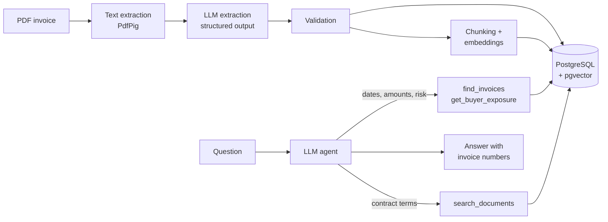

# InvoiceAI

AI-powered invoice processing for a factoring company: extract structured data from PDF invoices, ask questions about contract terms, and get answers about overdue invoices and buyer risk in plain language.

Built with .NET 10, Microsoft.Extensions.AI, OpenAI, PostgreSQL and pgvector.

> All companies and invoices in `TestData` are fictional.

## The problem

In factoring, a company sells its unpaid invoices to a factor to get cash early. The factor's daily work is invoices: staff open PDFs, copy seller, buyer, amounts and due dates into a system by hand, and then answer questions like *"Which invoices are overdue?"*, *"What is our exposure to this buyer?"* or *"What penalty applies if they pay late?"*

InvoiceAI automates that work:

- **Extraction:** upload a PDF, get validated structured data in ~4 seconds for ~$0.0002. Manual entry takes 3–5 minutes per invoice.
- **Questions:** an agent answers in English or Azerbaijani, using the database for numbers and dates and semantic search for contract terms, always citing invoice numbers.

## Architecture



## Key design decisions

| Decision | Why |
| --- | --- |
| `IChatClient` abstraction (Microsoft.Extensions.AI) | Provider-agnostic code. Switching OpenAI API or provider changes one line in `Program.cs`. |
| Structured output + validation | The model returns a typed C# object. Code checks `subtotal + VAT = total` and date order. Failures are marked `NeedsReview` for a human instead of being rejected or silently accepted. |
| Read-only, parameterized tools | The LLM never writes SQL. It chooses filters; the code builds the query. No risk of data changes or injection. |
| Today's date in the prompt, overdue days computed in code | Without it, the model silently assumed the current date in tests. |
| RAG for text, SQL tools for numbers | Semantic search failed on "which invoices are overdue?" because it only sees a few chunks. Structured questions go to the database. |
| Hybrid search | The agent first filters invoices (e.g. overdue), then searches contract terms only inside them. |
| Multi-query search | Embeddings are weak across languages. The question is rewritten in English and Azerbaijani before searching. |
| Context header on every chunk | Each chunk starts with invoice number, seller and buyer, so "Nord Trade penalty" finds the right clause. |
| pgvector instead of a separate vector DB | One database for data and vectors: simpler and cheaper at this scale. |
| `text-embedding-3-small` | 6.5x cheaper than `large`; no visible quality difference on short invoices. |

## What I measured

Full notes with every experiment: [`docs/notes.md`](docs/notes.md).

**Extraction:** 3/3 test invoices fully correct, including Azerbaijani number format (`33 984,00`) and a due date calculated from "payment within 45 days".

**Retrieval experiments:**
- Smaller chunks (800 → 300 chars) improved same-language search (distance 0.72 → 0.58).
- Cross-language search stayed weak until multi-query rewriting was added.
- No distance threshold works: an off-topic question scored closer than a correct match. The "not found" decision is made by the LLM.

**Agent:** 5/5 test questions correct after fixing two problems found through tool-call logs:
- A tool failed silently (EF Core could not translate a query). Fixed by making tool errors and results visible in development.
- The agent gave a correct answer by the wrong path (skipped checking overdue status). Fixed with a prompt rule and a filter on the search tool. **Lesson: check the agent's path, not only its answer.**

**Evals:** 7 LLM evals + unit tests. One full eval run: 12 LLM calls, ~$0.0015, ~17 s. Pass rate 7/7 over 3 runs after fixes. Fuzzy criteria are checked with an LLM judge.

**Cost per operation (gpt-6-luna):**

| Operation | Cost | Time |
| --- | --- | --- |
| Extract one invoice | ~$0.0002 | ~4 s |
| RAG question | ~$0.0003 | 4–7 s |
| Multi-step agent question | ~$0.0004 | ~7 s |

## Run it

Requirements: Docker and an OpenAI API key.

```bash
cp .env.example .env      # then put your API key in .env
docker compose up -d --build
```

API: `http://localhost:8080`. Upload the test invoices and ask questions with the requests in `InvoiceAI.Api/InvoiceAI.Api.http`.

Run tests:

```bash
dotnet test --filter "Category!=Eval"   # unit tests, no API calls
dotnet test --filter "Category=Eval"    # LLM evals, needs API key and test data in the database
```

## API

| Method | Endpoint | Description |
| --- | --- | --- |
| POST | `/api/invoices` | Upload a PDF, extract, validate, store and index it |
| GET | `/api/invoices` | List invoices |
| POST | `/api/invoices/reindex` | Recompute embeddings (e.g. after changing the embedding model) |
| GET | `/api/search?q=` | Semantic search over invoice chunks |
| POST | `/api/qa` | RAG answer with sources |
| POST | `/api/agent` | Agent answer with tool calls and tool results |

## Known limitations and next steps

- Only text PDFs; scanned invoices need OCR or a vision model.
- Buyer exposure sums all currencies together; should group by currency.
- No payment status yet: all invoices are treated as unpaid.
- The agent runs with `reasoning_effort = none`, because the Chat Completions API does not support tools with reasoning for this model. Next step: the Responses API.
- Evals use the development database and depend on today's date. Next step: Testcontainers with seeded test data.
- Migrations run on startup for the demo only; in production they belong in the deployment pipeline.
- No authentication: this is a prototype.

## Tech stack

.NET 10 · ASP.NET Core Minimal APIs · Microsoft.Extensions.AI · OpenAI (gpt-6-luna, text-embedding-3-small) · EF Core · PostgreSQL 17 · pgvector · PdfPig · xUnit · Docker Compose